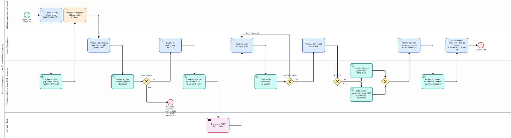
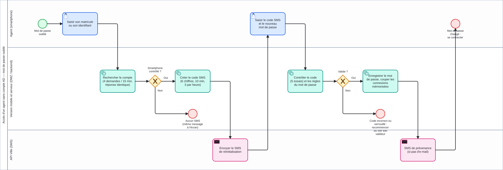

# Accès à l'outil pour les agents sans compte Active Directory

> Principes d'accès, parcours, mesures de sécurité et exploitation. Les règles métier correspondantes sont dans `backend/REGLES_METIER.md` (section 9) ; le détail technique
> est dans `MANIFEST.md` (exigences **ACT-01** à **ACT-04**). Les diagrammes BPMN sont dans `docs/bpmn/` (à importer dans le module BPMN d'AppDSI).

## 1. Objet

Les agents de la Ville se connectent normalement avec leur compte Active Directory (AD). Certains n'en ont pas (agents d'entretien, de restauration scolaire, saisonniers…).
Ils accèdent à l'outil **uniquement par la version mobile**, publiée en DMZ (`conges-mobile-dmz`), avec un compte local qu'ils activent eux-mêmes grâce à un code remis par leur valideur.

## 2. Principes

| Principe | Application |
|---|---|
| **Aucune preuve fondée sur des données connues de tous** | L'API Sedit RH ne fournit ni date de naissance, ni téléphone, ni adresse (volontairement) : on ne s'en sert pas. Le matricule désigne la personne, il ne la prouve pas. |
| **La preuve d'identité est un acte humain** | Le **valideur** de l'agent (ou un administrateur) génère un **code d'activation** à usage unique et le remet à l'agent (papier, en main propre) : seul quelqu'un qui connaît l'agent peut le faire. |
| **Le canal de contrôle est contrôlé** | Le smartphone est contrôlé par un **code SMS** : le numéro saisi n'est enregistré qu'après saisie du code reçu. Il sert ensuite à réinitialiser le mot de passe et à confirmer les demandes si l'agent n'a pas d'e-mail. |
| **Rien ne révèle l'existence d'un compte** | Réponse identique que le matricule existe ou non, que le smartphone soit enregistré ou non. |
| **Secrets stockés hachés** | Code d'activation, code SMS, jetons « se souvenir de moi » : seuls des hachés sont en base. Le code d'activation n'est montré qu'une fois. |
| **Tout est limité et tracé** | Essais, envois de SMS, débits par adresse et par matricule ; chaque étape dans le journal des connexions. |
| **Minimisation** | Aucune donnée sensible nouvelle : le numéro de smartphone (contrôlé) et, facultativement, l'adresse e-mail. |

## 3. Parcours

### 3.1 Activation du compte (première connexion)

1. **Valideur** : dans *Mon équipe*, sur la carte de l'agent (repère « ⚠ AD »), bouton **🔑 Activation**. Prérequis : l'agent est actif, a un matricule et n'a pas d'identifiant AD.
   Le serveur génère un code `XXXXX-XXXXX` (valable **7 jours**, usage unique) ; un **document A4 imprimable** s'ouvre (code, matricule, QR code, marche à suivre). Un nouveau code **remplace** le précédent.
2. **Agent** : ouvre la version mobile (QR code ou adresse), **Première connexion**, saisit **matricule + code** (le QR code les préremplit).
3. **Agent** : saisit son **smartphone** (06/07) ; il reçoit un **SMS** à 6 chiffres (10 minutes) et le saisit.
4. **Agent** : indique son **e-mail — facultatif**. Sans e-mail, ses confirmations de demandes et de validations lui arrivent **par SMS** (voir 3.4).
5. **Agent** : choisit son **mot de passe** (10 caractères au moins, lettres et chiffres, sans son identifiant, son matricule ni son numéro).
6. Le compte est activé ; l'agent est prévenu (e-mail s'il en a un) ; il se connecte avec son **matricule** et son mot de passe.

### 3.2 Connexion courante

- **Identifiant ou matricule** + mot de passe.
- **« Se souvenir de moi »** (30 jours) : un jeton aléatoire est posé dans un cookie `HttpOnly` ; seul son haché est conservé (5 appareils au plus). Il est supprimé à la déconnexion et à chaque changement de mot de passe. Non proposé aux administrateurs.
- **Empreinte / Face ID** : sur un téléphone compatible (navigateur en HTTPS), un bouton 🔓/🔒 active un **verrou local** (WebAuthn, vérification de l'utilisateur obligatoire) demandé à l'ouverture de l'application. Il protège un téléphone déverrouillé prêté ou volé ; il **ne remplace pas** le mot de passe et n'est pas vérifié par le serveur (voir § 6).

### 3.3 Mot de passe oublié

Possible **uniquement pour les agents dont le smartphone a été contrôlé** : matricule ou identifiant → SMS (6 chiffres, 10 minutes, 3 par heure) → code + nouveau mot de passe.
L'écran répond de la même façon dans tous les cas. Les connexions mémorisées sont coupées et l'agent est prévenu (e-mail, ou SMS à défaut). Sans smartphone contrôlé : le valideur génère un **nouveau code d'activation**.

### 3.4 Agents sans e-mail : confirmations par SMS

Quand une personne (agent **ou valideur**) n'a pas d'adresse e-mail mais un smartphone contrôlé, elle reçoit par SMS ce que les autres reçoivent par e-mail :

| Événement | Destinataire(s) |
|---|---|
| Demande envoyée | l'agent (confirmation) ; le valideur (nouvelle demande) |
| Demande validée ou refusée | l'agent ; le valideur qui a décidé (confirmation de sa décision) |
| Demande annulée, demande d'annulation, annulation acceptée ou refusée | l'agent ; le valideur le cas échéant |

Les SMS partent par l'API Ville, en arrière-plan : une panne n'empêche jamais l'action. Ils sont tracés dans le journal des e-mails (modèle « sms », numéro masqué).

### 3.5 Cas particuliers

- **Changement de smartphone ou compte bloqué** : le valideur génère un nouveau code d'activation ; l'agent refait le parcours (le nouveau numéro remplace l'ancien une fois contrôlé).
- **Départ de l'agent** : désactiver le compte dans l'application (il ne peut plus se connecter, ses connexions mémorisées cessent de fonctionner).
- **Agent qui reçoit un compte AD** : renseigner son identifiant AD (*Recherche AD*) ; il se connecte alors avec son mot de passe de la Ville.

## 4. Mesures de durcissement

| Mesure | Valeur |
|---|---|
| Code d'activation | 50 bits, sans caractères ambigus, 7 jours, usage unique, **5 essais** puis verrouillage |
| Réponse aux échecs | message unique « Informations incorrectes ou code expiré » |
| Limites | 10 échecs / 15 min par adresse ; 6 / 15 min par matricule ; 12 requêtes / minute par adresse au nginx, **sur toutes les entrées** (DMZ mobile, adresse de test `/mobile/`, ancienne DMZ complète) ; seul le port 8115 direct du backend mobile n'a que les limites du backend |
| SMS de contrôle | 6 chiffres, **10 minutes**, **3 envois** par activation, 1 minute entre deux, **5 essais** ; un numéro déjà contrôlé sur un autre compte est refusé |
| Mot de passe oublié | 6 chiffres, 10 minutes, 5 essais, 3 SMS par heure, 4 demandes / 15 min par identifiant |
| Mot de passe | 10 caractères, lettres et chiffres, sans identifiant / matricule / numéro ; haché comme les autres |
| Session | 10 h ; « se souvenir de moi » : 30 jours, jeton haché, révoqué à tout changement de mot de passe (par la personne, l'activation, la réinitialisation **ou un administrateur**) |
| Traçabilité | journal des connexions (événement `activation`), journal d'audit du compte, **journal des SMS** : tous les SMS (activation, contrôle, réinitialisation, prévenance, confirmations de demandes) sont dans le journal des e-mails, canal « sms », numéro masqué, état envoyé ou échec ; le code à usage unique n'y est jamais enregistré |
| Notification | e-mail (ou SMS) à l'agent à l'activation et à la réinitialisation |

## 5. Données et exploitation

- **Base** : `users.mobile`, `users.mobile_verifie_le` ; table `activations` (hachés, compteurs, échéances) ; table `remember_tokens` (hachés) ; migrations `0014_activation.sql` et `0015_remember.sql`.
- **Paramètres** : `CONGES_MOBILE_URL` (adresse publique de la version mobile, utilisée dans le QR code) ; la clé de l'application (`APM_API_KEY`) doit avoir le droit **`sms_send`** côté API Ville ; bibliothèque `segno` (QR code, dans `requirements.txt`) ; `CONGES_PROXY_HOPS` doit compter le nginx mobile.
- **Surface DMZ** : le nginx de `conges-mobile-dmz` ne relaie que les routes nécessaires (voir son README) ; les routes d'activation (`/api/activation/*`) sont sans session et limitées.
- **Coût** : chaque activation consomme 1 à 3 SMS ; chaque réinitialisation 1 SMS (+ 1 de prévenance sans e-mail) ; les confirmations de demandes ne sont envoyées par SMS qu'aux personnes **sans** e-mail.

## 6. Limites connues et points d'attention

- **Verrou biométrique** : contrôle local (WebAuthn non vérifié par le serveur). Un attaquant qui obtiendrait le cookie de session par un autre moyen n'est pas arrêté par lui ; la protection réelle reste le mot de passe, la durée du jeton et sa révocation. Une authentification WebAuthn complète (passkeys vérifiées côté serveur) est possible ultérieurement.
- **E-mail non vérifié** : l'adresse saisie par l'agent n'est pas contrôlée par un code ; elle ne sert qu'à des notifications (aucune action de validation n'est proposée à un agent par e-mail).
- **Compte « sans AD »** : l'application distingue « sans identifiant AD enregistré » de « sans compte AD ». Un compte dont l'identifiant d'application est aussi son nom AD s'authentifie par l'AD tant qu'il n'est pas activé ; ne générer un code que pour un agent qui n'a **réellement** pas d'AD.
- **SMS** : dépend de l'API Ville ; une panne empêche l'activation et la réinitialisation (nouvel essai plus tard).
- **Responsabilité** : la remise du code d'activation engage celui qui le génère (valideur) : le code ne doit être remis qu'à l'agent concerné.

## 7. Diagrammes BPMN

| Fichier | Contenu |
|---|---|
| `docs/bpmn/activation-agent-sans-ad.bpmn` (+ `.svg`) | Activation du compte : valideur, agent, version mobile et serveur, API Ville (SMS) |
| `docs/bpmn/mot-de-passe-oublie-agent-sans-ad.bpmn` (+ `.svg`) | Réinitialisation du mot de passe par SMS |

Conventions du module BPMN d'AppDSI : un pool et des couloirs ; le type de tâche porte le sens — **action humaine** (bleu), **automatique** (turquoise), **manuelle** (orange), **communication** (rose), décision (jaune), début (vert), fin (rouge).
Pour les modifier : ouvrir le fichier `.bpmn` dans l'éditeur BPMN d'AppDSI (import XML) ; la mise en page est incluse.
